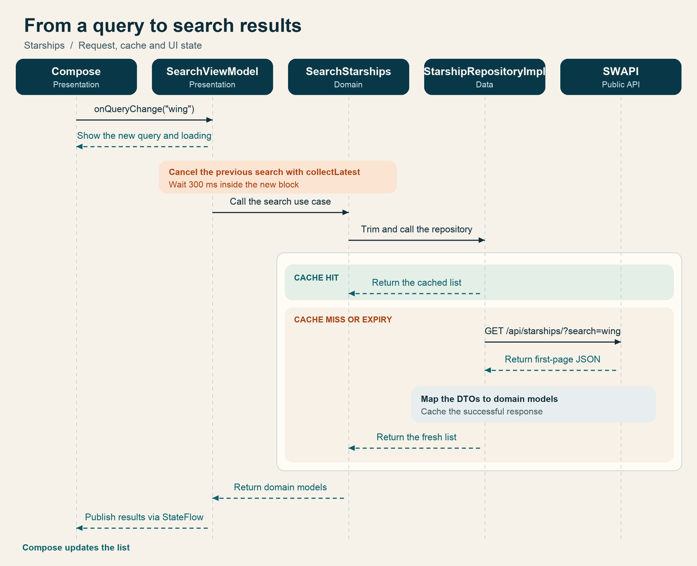

# Decisiones técnicas

## Alcance y elección de la API

Elegí Star Wars porque me apetecía trabajar con un tema que me gusta. SWAPI ya ofrecía los datos necesarios para buscar por nombre o modelo y abrir una ficha por ID. Ese ID se puede sacar de la URL del recurso. [Documentación de SWAPI para naves](https://swapi.dev/documentation#starships)

Al integrar SWAPI vi que las respuestas venían sin imágenes. Buscando encontré en Reddit **Star Wars Gallery**. El CDN usa los mismos IDs, así que puedo cargar la imagen correspondiente por separado. Si el CDN falla, la pantalla conserva los datos de la nave y muestra un icono local de radar. [Origen de las imágenes y ejemplo de URL](../README.md#imágenes-de-las-naves)

## Por qué elegí estas librerías

| Librería | Por qué la elegí |
|---|---|
| **Jetpack Compose y Material 3** | Elegí Jetpack Compose porque la app partía de cero y quería usar la herramienta moderna que Google recomienda para crear interfaces nativas de Android con Kotlin. Usé Material 3 para tener una base común de componentes y aplicar el mismo tema en la búsqueda y la ficha. Si en el futuro quisiera compartir la interfaz con iOS, ya partiría del mismo modelo declarativo y podría adaptar las pantallas a Compose Multiplatform. [Jetpack Compose en Android Developers](https://developer.android.com/compose) · [Compose Multiplatform](https://kotlinlang.org/compose-multiplatform/) |
| **Koin** | Elegí Koin porque podía configurar las dependencias de esta app pequeña directamente en Kotlin, en el punto donde se ensamblan los módulos. Así, los ViewModels y los casos de uso reciben sus dependencias por constructor y puedo probarlos con dobles. También me interesaba que Koin se pudiera mantener si el proyecto crece hacia Kotlin Multiplatform, con dependencias comunes y otras específicas de Android o iOS. [Koin en Kotlin Multiplatform](https://insert-koin.io/docs/reference/koin-mp/kmp/) |
| **Retrofit, OkHttp y Kotlin Serialization** | La entrega era una app nativa solo para Android. Elegí Retrofit con OkHttp porque encajaba con ese alcance y me permitía definir la búsqueda y el detalle como funciones `suspend` tipadas. También cubría un requisito de la prueba, al cancelar la corrutina de búsqueda, se cancela la petición HTTP. Usé Kotlin Serialization para convertir las respuestas JSON en DTO y leer los campos que necesita la app. Si el encargo hubiera pedido compartir la capa de red entre Android e iOS con Kotlin Multiplatform, habría elegido Ktor Client. Me habría permitido declarar las peticiones y la configuración común en Kotlin compartido, con un motor HTTP para cada plataforma. En este proyecto, el contrato del repositorio marca dónde haría ese cambio. [Plataformas de Ktor Client](https://ktor.io/docs/client-supported-platforms.html) |
| **Navigation Compose** | Elegí Navigation Compose porque las dos pantallas ya estaban hechas con Compose y el recorrido era sencillo. La ruta de detalle recibe el ID de la nave, y al volver se recuperan la consulta y los resultados que siguen en la pantalla de búsqueda. |
| **Coil** | Elegí Coil porque ya lo conocía y su `AsyncImage` encajaba con Compose. Las imágenes del CDN tienen su propia carga y caché, así que puedo mostrar los datos en cuanto llegan y usar el icono local mientras se carga la imagen. Si llegara a compartir la interfaz, Coil 3 también permite usar `AsyncImage` con Compose Multiplatform. [Coil con Compose](https://coil-kt.github.io/coil/compose/) |

## Límites entre módulos

```text
:app          → :presentation, :data
:presentation → :domain
:data         → :domain
:domain       → ningún otro módulo del proyecto
```

Las flechas muestran las dependencias de Gradle. `:domain` define los modelos, los casos de uso y la interfaz `StarshipRepository`. `:data` implementa esa interfaz, convierte los DTO en modelos de dominio y gestiona la caché. `:presentation` llama a los casos de uso y utiliza los modelos de dominio para mostrar los datos. `:app` monta la navegación y las dependencias, y accede a Data a través de `dataModule`.

Esta separación me permite simular resultados, fallos y cancelaciones en las pruebas del ViewModel. También puedo cambiar el cliente HTTP o la caché dentro de Data mientras mantenga el contrato del repositorio. Las pruebas de arquitectura verifican ese límite y comprueban que los ViewModels usan casos de uso inyectados por constructor.

Durante una búsqueda, el ViewModel llama a `SearchStarships`, que pertenece a Domain. Ese caso de uso llama a la interfaz `StarshipRepository` y Koin le proporciona la implementación de Data. En Gradle, la dependencia va de Data a Domain porque la interfaz está definida allí.

## Del buscador a la pantalla



[Abrir el diagrama de búsqueda](./search-flow.png)

1. Al escribir `wing`, Compose envía la edición a `SearchViewModel`. El ViewModel recibe las ediciones en un flujo y publica el estado de la pantalla en un `StateFlow` de solo lectura. Compose lo observa respetando el ciclo de vida.
2. `collectLatest` cancela el trabajo anterior al recibir una edición. Dentro del bloque nuevo espera 300 ms antes de llamar a `SearchStarships`. Una consulta vacía devuelve la pantalla al estado inicial. Si ya había una llamada HTTP en curso, la cancelación llega hasta esa llamada.
3. El caso de uso valida la consulta y llama al repositorio. Si hay una respuesta vigente para esa consulta normalizada, Data devuelve la lista de la caché. Cuando la entrada ha caducado o todavía no existe, pide la primera página a SWAPI, mapea el JSON y guarda la respuesta correcta. La caché guarda cada página en memoria durante tres minutos y también admite respuestas sin coincidencias. Las pruebas controlan un reloj monotónico para comprobar cuándo caduca.
4. Antes de publicar un resultado o un error, el ViewModel comprueba que el trabajo siga activo y que la edición corresponda a la consulta actual. Un fallo de red se convierte en un error tipado. Compose actualiza la pantalla con el estado publicado.

Si SWAPI indica que quedan páginas, aparece **Cargar más**. La app pide la siguiente página con la misma consulta, añade sus naves por ID y conserva las filas mientras carga o si hay que reintentar. Cambiar la consulta cancela esa petición y empieza de nuevo en la primera página.

Al tocar una fila se abre la ficha por ID. `GetStarship` obtiene sus datos y el ViewModel de detalle publica el estado. Coil carga la imagen de forma independiente tanto en la lista como en la ficha.

## Accesibilidad y animación

- Las etiquetas y los mensajes de la app viven en recursos. El buscador es editable y tiene etiqueta. Las acciones de limpiar y volver tienen descripciones traducidas.
- Cada tarjeta de resultados se puede pulsar como un único elemento. Los títulos cuentan con semántica de encabezado y en la ficha se agrupan las etiquetas y sus valores. Los iconos e imágenes decorativos quedan fuera de la lectura.
- Durante la carga se muestra texto y se expone semántica de progreso indeterminado. El emblema rebelde gira mientras dura la búsqueda. Los mensajes de estado pueden anunciarse mediante regiones activas de prioridad moderada.
- En pantallas estrechas o con letra grande, las tarjetas y los campos de la ficha se apilan.

## Validación

| Área | Qué comprueba |
|---|---|
| Dominio | Validación de consultas, recorte de espacios y acceso al repositorio por su contrato. |
| Datos | Mapeo, uso de la caché a los 2:59, caducidad a los 3:00, actualización y reintentos con un servicio simulado y un reloj controlado. |
| Presentación | Cancelación antes de que termine la espera de la nueva consulta, descarte de resultados y errores antiguos, y estados de carga y reintento del detalle. |
| App | Configuración de Koin y reglas de dependencia entre módulos en el código fuente. |
| Compose | Edición y limpieza de la búsqueda, aviso de cancelación, búsqueda sin coincidencias, etiquetas y valores de la ficha y vuelta a la misma consulta. Se usan datos controlados y un recurso local para las imágenes. |

--
